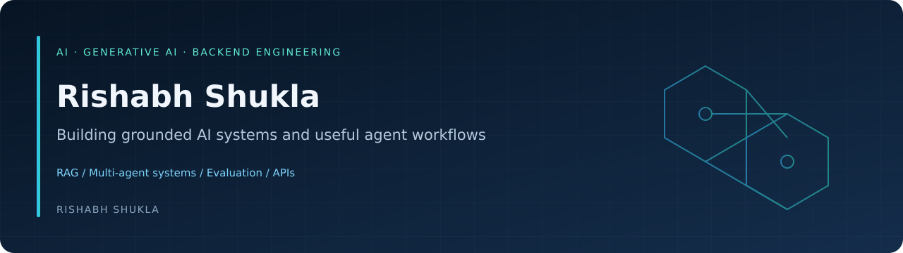

  

  <a href="https://my-portfolio-website-topaz-beta.vercel.app/"><strong>Portfolio & demos</strong></a>
  &nbsp; · &nbsp;
  <a href="mailto:rs6739171@gmail.com"><strong>Contact</strong></a>
  &nbsp; · &nbsp;
  <a href="https://github.com/rs6739171-hash?tab=repositories"><strong>Repositories</strong></a>

## Hi, I'm Rishabh

I build Python applications that connect language models with useful tools, retrieved evidence, and human review. My work spans **agentic RAG, multi-agent workflows, AI evaluation, and authenticated backend APIs**.

- **Education:** BS in Data Science and AI, IIT Madras.
- **Project focus:** grounded answers, clear workflow state, explicit approval, and useful evaluation reports.
- **Currently strengthening:** Python problem solving, Docker, deployment, and AI operations.
- **Open to opportunities:** AI, GenAI, RAG, and Python backend roles.

## Featured work

<table>
<tr>
<td width="50%" valign="top">

### Enterprise Agentic RAG
A Kubernetes documentation assistant with retrieval, reranking, guardrails, and a dedicated evaluation application.

**LangGraph · Qdrant · FastAPI · FlashRank**

[Explore source](https://github.com/rs6739171-hash/Enterprise_Agentic_RAG) · [Evaluation demo](https://enterprise-rag-rishabh.onrender.com/?page=evaluation)

</td>
<td width="50%" valign="top">

### Multi-Agent Market Analyst
Fundamental and technical analyst agents produce a research memo after explicit human approval.

**LangGraph · Pandas · FastAPI · Streamlit**

[Explore source](https://github.com/rs6739171-hash/Market_Analyst_Agent) · [Demo](https://market-analyst-rishabh.onrender.com/)

</td>
</tr>
<tr>
<td width="50%" valign="top">

### Multi-Agent Travel Planner
A supervisor coordinates travel specialists, tool integrations, itinerary revision, and approval.

**LangGraph · MCP · PostgreSQL · Streamlit**

[Explore source](https://github.com/rs6739171-hash/Travel_Planner_System) · [Demo](https://travel-planner-rishabh.onrender.com/)

</td>
<td width="50%" valign="top">

### Employee Management System
An employee CRUD application with JWT authentication, protected REST endpoints, and one-hour access tokens.

**Flask · SQLAlchemy · JWT · PostgreSQL**

[Explore source](https://github.com/rs6739171-hash/Employee_Management_System_JWT)

</td>
</tr>
</table>

Hosted AI demos may require a demo password and time to start. Use my portfolio for demo access details.

## Tools I use

| Area | Tools and practices |
| :--- | :--- |
| Development | Python, SQL, FastAPI, Flask, Streamlit |
| AI workflows | LangGraph, retrieval-augmented generation, tool integration, human-in-the-loop |
| Retrieval & data | Qdrant, FlashRank, PostgreSQL, Pandas |
| Quality & delivery | Evaluation rubrics, guardrails, regression tests, GitHub Actions, Render |

## More projects

My [portfolio](https://my-portfolio-website-topaz-beta.vercel.app/) also features **KubeScope**, a Kubernetes investigation assistant; a **synthetic-data clinical EHR validator**; and an **explainable credit-risk project with SHAP**.

These are portfolio projects. Individual repository documentation explains implemented behavior, setup, evaluation, and current limitations.

---

  <strong>Interested in my work?</strong> 
  <a href="mailto:rs6739171@gmail.com">rs6739171@gmail.com</a>
  &nbsp; · &nbsp;
  <a href="https://my-portfolio-website-topaz-beta.vercel.app/">View portfolio</a>

